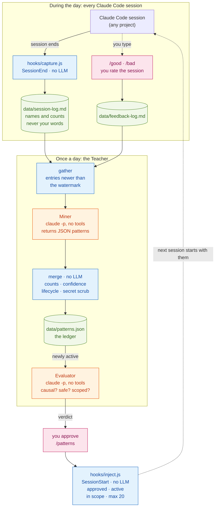

# claude-self-learning-loop

**Claude Code that learns how you work, from your own sessions, without fine-tuning.**

Hooks record what happens in each session: tool names, file names, and how often you corrected or thanked Claude, never your actual words. Once a day a **Teacher** asks Claude to spot recurring patterns. A sceptical **Evaluator** throws out the weak ones, you approve the rest, and only patterns that keep showing up get injected into new sessions.

Plain Node, zero dependencies: two hooks, one small CLI, three slash commands.

> Claude's weights are frozen, so this isn't reinforcement learning. It is *conditioning*: capture, feedback, mining, injection. The loop changes what Claude reads at the start of a session, not the model itself.

## The loop



| Colour | Meaning |
|---|---|
| Blue | Plain scripts, no LLM. They always exit 0, so they can't break a session. |
| Orange | The only two model calls. Both run with no tools: text in, JSON out. |
| Green | Files on your disk, in the git-ignored `data/` folder. |
| Pink | You. |

## How it works

| # | Step | What happens | Who |
|---|---|---|---|
| 1 | **Capture** | When a session ends, `capture.js` reads the transcript and appends one entry: tools used, file names, and counts of corrections, approvals, tool errors and files edited 3+ times. Your words are read in memory to count; they are never written. | script |
| 2 | **Rate** | `/good` or `/bad`, with an optional note. The strongest signal the Teacher gets. | you |
| 3 | **Gather** | Once a day, `teacher.js run` collects only entries newer than the watermark, so each session is mined exactly once. | script |
| 4 | **Mine** | Sends them, plus the keys of patterns it already knows, to `claude -p --tools ""`. Gets back `[{key, rule, evidence}]`. | Claude |
| 5 | **Merge** | `ledger.js` does all the bookkeeping: counts, dates, confidence, lifecycle, secret scrubbing. | script |
| 6 | **Judge** | Every pattern that just became active goes to the Evaluator once. | Claude |
| 7 | **Approve** | `/patterns` lists them with the Evaluator's verdict. You approve by number. | you |
| 8 | **Inject** | `inject.js` puts the approved, active, in-scope patterns at the top of every new session. | script |

One capture entry looks like this:

```
## 2026-03-11T16:42:09.512Z — session 7f3a9c1e
- cwd: /home/dev/payments-api
- signals: tools[Edit:9 Read:7 Bash:5] edited[refund.ts invoice.ts] read[refund.ts money.ts] msgs:64
- feedback: corrections:3 approvals:1 toolErrors:2 rework[refund.ts:5]
```

## Why it doesn't rot your context

A memory that injects everything it has slowly fills the context with noise. Here a pattern has to clear six gates:

| Gate | What it keeps out | Where |
|---|---|---|
| **Recurrence** | One dramatic session. A pattern has to resurface on 3 *different days* before it is even eligible. | `teacher/ledger.js` |
| **Evaluator** | Spurious correlations, unsafe or vague rules, wrong scope. Each pattern is judged once. | `teacher/evaluator-prompt.md` |
| **You** | Anything you don't want. The Evaluator only recommends unless you switch on auto-approve. | `/patterns` |
| **Scope** | One project's habits leaking into another. A scoped pattern injects only when its token is in the folder path. | `hooks/inject.js` |
| **Cap** | Prompt bloat. At most 20 rules per session, highest confidence first. | `teacher/ledger.js` |
| **Decay** | Old habits. Unseen for 90 days: archived, and it stops injecting. Seen once, then never again within 30 days: deleted. | `teacher/ledger.js` |

### Pattern lifecycle

```
day 1  seen          candidate  20%   not injected
day 2  seen again    candidate  40%   not injected
day 3  seen again    active     60%   eligible -> Evaluator -> you -> injected
       each new day  +20%, up to 95%
unseen for 90 days   archived         stops injecting; comes back if it resurfaces
seen once, still once after 30 days   deleted as noise
```

Confidence counts **days**, not sessions or runs. A habit has to persist; it can't spike its way in.

### What a pattern looks like

```json
{
  "key": "run-tests-before-claiming-done",
  "rule": "Run the project's tests and show the result before saying a fix works.",
  "obsCount": 4, "confidence": 80, "status": "active",
  "firstSeen": "2026-03-02", "lastSeen": "2026-03-11",
  "evidence": ["2 BAD ratings say 'said fixed, tests still failing'; sessions that ran tests drew approvals"],
  "recommend": true,
  "evalReason": "Causal: the false 'done' is what drew the BAD ratings. Safe, actionable, applies everywhere.",
  "scope": "global",
  "approved": true
}
```

And this is what the next session starts with:

```
[learned-patterns] Behavioural preferences mined from your past sessions and vetted before use. Treat them as observed defaults: apply where relevant, defer to explicit instructions.
- Ask before adding a new dependency. _(stated by you)_
- Run the project's tests and show the result before saying a fix works. _(conf 80%, seen 4x)_
- Keep database migrations in their own commit. _(conf 60%, seen 3x, scope payments-api)_
```

## Design decisions

| Decision | Why |
|---|---|
| **Claude judges, scripts count** | Models are unreliable at incrementing counters and dates; a script is exact. The model only says *which* patterns it sees. |
| **Show the model the keys it already used** | Otherwise it invents a new key for the same habit every night, and the evidence never adds up. |
| **Store counts, not words** | Corrections and approvals are counted with a regex, in memory. The log holds names and numbers only. |
| **Every model call runs with `--tools ""`** | No file access. All writes happen in plain code, and a malformed reply leaves the ledger untouched. |
| **Facts are not patterns** | "The bug was in the cache layer" belongs in that project's `CLAUDE.md`. The ledger keeps only ways of working that still make sense in an unrelated project. |
| **Rules you state skip the recurrence gate** | You say a rule once, so it never "recurs" 3 times and a statistical gate buries it. `teacher.js add` stores it as a directive, still scoped. |
| **Wording freezes once reviewed** | Otherwise the miner could rephrase an approved rule into something nobody reviewed. |
| **The watermark stops at the last entry read** | If one day's input hits the size cap, the rest waits for the next run instead of being skipped. |
| **A role, not a second install** | I first planned a separate "Teacher" Claude with a sync pipeline. Hooks already isolate failures and git already gives rollback, so the pipeline was pure maintenance. |

## Things that bit me

| Problem | Fix |
|---|---|
| The miner loves correlations: *"sessions where Claude asked questions had more corrections, so ask fewer questions."* Hard tasks cause both. | Evaluator test 1: causal, not correlational. |
| A headless `claude -p` inherits your interactive settings. With always-on thinking and maximum effort, every nightly run blew through its budget cap. | The miner runs with thinking off and `--effort medium` (`teacher/headless-settings.json`). |
| A failed run that exits 0 stays invisible for days. | Exit 1 and log the real reason. It is in the JSON result on stdout, not on stderr. |
| A fixed clock time misses every night the laptop is asleep or offline. | The SessionStart hook wakes the Teacher if it hasn't run in 20 hours. If you're starting a session, the machine is on and online. |
| A failing background run could respawn on every session start. | The wake-up stamp is written *before* the spawn. |
| On Windows, a detached child got no console, and the background run (PowerShell, in my case) exited 0 having done nothing. Its output was discarded, so nobody noticed for weeks. | Don't detach on Windows; `unref()` is enough to outlive the hook. Send stderr to a log, never to nowhere. |
| The background run starts at the same moment your new session refreshes its login token, and one of them loses. | Retry once after 75 seconds on that specific error. |
| The Teacher's own headless sessions got captured, and showed up in the session list. | It sets `CLAUDE_TEACHER_ACTIVE=1`, which every hook checks, and runs with `--no-session-persistence`. |
| Several patterns turning active at once made one Evaluator call too expensive. | Judge each pattern once, at most 2 per run. |

## Install

Needs Node 18+ and a logged-in Claude Code CLI.

**macOS / Linux**

```bash
git clone https://github.com/bhargavvc/claude-self-learning-loop ~/.claude/self-learning-loop
mkdir -p ~/.claude/commands && cp ~/.claude/self-learning-loop/commands/*.md ~/.claude/commands/
node ~/.claude/self-learning-loop/test.js
```

**Windows (PowerShell)**

```powershell
git clone https://github.com/bhargavvc/claude-self-learning-loop "$HOME\.claude\self-learning-loop"
New-Item -ItemType Directory -Force "$HOME\.claude\commands" | Out-Null; Copy-Item "$HOME\.claude\self-learning-loop\commands\*.md" "$HOME\.claude\commands\"
node "$HOME\.claude\self-learning-loop\test.js"
```

Then add the two hooks to `~/.claude/settings.json`. On Windows, replace `~` with your full home path, e.g. `node "C:/Users/you/.claude/self-learning-loop/hooks/capture.js"`.

```json
{
  "hooks": {
    "SessionEnd": [
      { "hooks": [{ "type": "command", "command": "node ~/.claude/self-learning-loop/hooks/capture.js", "timeout": 15 }] }
    ],
    "SessionStart": [
      { "hooks": [{ "type": "command", "command": "node ~/.claude/self-learning-loop/hooks/inject.js", "timeout": 5 }] }
    ]
  }
}
```

That's it. The first SessionStart wakes the Teacher; there is nothing to schedule.

## Daily use

| When | Do |
|---|---|
| Normal work | Nothing. Each session is captured when it ends. |
| A session went notably well or badly | `/good` or `/bad what went wrong` |
| Every few days | `/patterns`, then `approve 1 3` or `approve recommended` |
| A rule you already know you want | `node ~/.claude/self-learning-loop/teacher/teacher.js add "Ask before adding a dependency" --scope web` |
| See exactly what would be sent, with no API call | `node ~/.claude/self-learning-loop/teacher/teacher.js run --dry-run` |
| Check what the runs did | `data/runs.log` |

Prefer a fixed schedule? Run `node teacher/teacher.js run` from cron or Task Scheduler. A run with nothing new makes no model call.

## Tuning

| Knob | Where | Default |
|---|---|---|
| `AUTO_APPROVE`: let the Evaluator's verdict inject without you | `teacher/teacher.js` | `false` |
| Model | `TEACHER_MODEL` environment variable | `sonnet` |
| Budget cap per call, miner / Evaluator | `teacher/teacher.js` | $0.60 / $0.40 |
| Patterns judged per run | `EVAL_PER_RUN` in `teacher/teacher.js` | 2 |
| Injection floor and cap | `FLOOR`, `MAX` in `teacher/ledger.js` | 60%, 20 |
| Lifecycle (3 days, 90 days, 30 days) | `statusFor()` in `teacher/ledger.js` | |
| How often the Teacher wakes | `WAKE_EVERY_HOURS` in `hooks/inject.js` | 20 |
| What to mine, how strictly to judge | `teacher/teacher-prompt.md`, `teacher/evaluator-prompt.md` | |

## Cost

Measured on my own setup with Sonnet: about **$0.10–0.30 per daily run** once caught up. The first run, over a two-week backlog, was about $0.50. Every call is hard-capped with `--max-budget-usd`. Most of the cost is Claude Code loading your `CLAUDE.md`, not the analysis itself.

## Privacy

| Data | Written to `data/` | Sent to Claude |
|---|---|---|
| The text of your messages | Never. Read in memory to count corrections and approvals. | No |
| Tool names, file names (not contents) | `session-log.md` | Yes, by the Teacher |
| The project folder path | `session-log.md` | Yes; it's how scoping works |
| Your `/good` and `/bad` notes | `feedback-log.md` | Yes |
| File contents | Never | Never |

Secrets and email addresses are scrubbed again before anything enters the ledger. `data/` is git-ignored.

## Files

| File | Lines | What it does |
|---|---|---|
| `hooks/capture.js` | 71 | SessionEnd: transcript in, one entry of names and counts out |
| `hooks/inject.js` | 43 | SessionStart: inject approved patterns; wake the Teacher once a day |
| `teacher/teacher.js` | 225 | The Teacher CLI: `run`, `list`, `approve`, `hold`, `add`, `rate` |
| `teacher/ledger.js` | 139 | Pure bookkeeping: confidence, lifecycle, scrubbing, merge, verdicts, selection |
| `teacher/teacher-prompt.md` | 38 | What to mine, and what never to |
| `teacher/evaluator-prompt.md` | 26 | The four tests |
| `commands/*.md` | 26 | `/good`, `/bad`, `/patterns` |
| `test.js` | 161 | 10 checks of the whole loop, with no API calls |

## Limitations

- **The sentiment counting is crude.** "no" and "still" count as corrections. It is a weak signal by design, and `/good` and `/bad` outweigh it.
- **Confidence measures recurrence, not correctness.** That is why the Evaluator and your approval exist.
- **One person, one machine.** There is no sync or team sharing; copy `data/patterns.json` if you want that.
- **Windows-first.** The loop this repo comes from runs every day on my Windows 11 machine with Claude Code 2.1, and this cleaned-up version passes its self-test there. macOS and Linux run the same plain Node code but have seen less use. Issues are welcome.

## License

MIT
